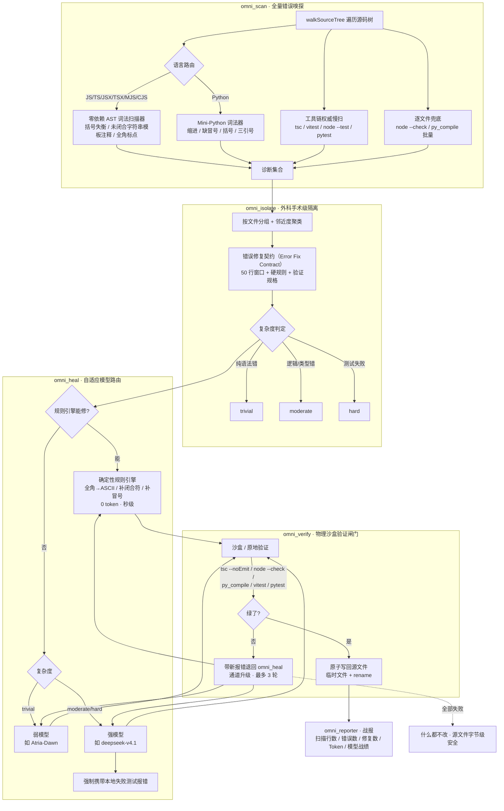

# Omni-Fixer · 万法归宗全自动代码修复流水线

> 不限模型能力（强弱皆可）、不限代码规模（支持 10 万行级屎山），
> 在 **Win7 / 8G 内存** 的低配宿主上也能跑的全自动代码错误修复 DSH 插件。

核心思想：打破"大模型上下文限制"和"模型智力鄙视链"。弱模型修不好大项目，
不是模型蠢，而是**上下文太杂、定位不准**。Omni-Fixer 用
「极致切分（Error Fix Contract）+ 物理沙盒验证 + 强弱模型混合路由」，
把任何一个错误压缩成模型只需看 50 行的隔离任务：

**模型不需要理解整个屎山，只需要修好眼前这一个报错。**

---

## 一、强弱模型协同修复架构图



纯文本版（GitHub 之外也能看）：

```
屎山项目
  │
  ▼
omni_scan        AST 快扫(0 依赖) ──┬── 工具链权威扫(tsc/vitest/pytest/node --test)
                                  └── 逐文件兜底(node --check / py_compile)
  │  诊断集合（severity=error 才进入流水线）
  ▼
omni_isolate     按文件分组 → 邻近聚类 → 错误修复契约
                 每份契约 = 50 行窗口 + 硬规则 + 验证规格 + 复杂度(trivial/moderate/hard)
  │
  ▼
omni_heal        规则引擎能修? ──是──▶ 确定性规则秒修（0 token）
                     │否
                     ├── trivial  ──▶ 弱模型（Atria-Dawn）
                     └── moderate/hard ▶ 强模型（deepseek-v4.1，强制带失败测试报错）
  │  补丁（绝不直接落盘）
  ▼
omni_verify      物理沙盒：单文件验证器丢临时目录跑；全工程验证器镜像工程（junction）
                 tsc --noEmit / node --check / py_compile / vitest / pytest
       ┌─────────绿─────────┐        ┌─────红─────┐
       ▼                    │        │            ▼
   原子写回源文件            │       带新报错退回重试（通道升级，最多 3 轮）
       ▼                    │            ▼
omni_reporter  战报         └─ 全部失败 ──▶ 什么都不改（源文件字节级安全）
```

---

## 二、为什么这套设计能"以弱胜强"

| 传统做法的困境 | Omni-Fixer 的解法 |
|---|---|
| 把整个文件甚至整个项目塞给模型，上下文 Rubik's cube | **错误修复契约**：模型只看 50 行窗口 + 一条明确报错 |
| 弱模型修语法错浪费强模型 token，强模型修逻辑错又不放心 | **自适应路由**：规则引擎 → 弱模型 → 强模型，逐级升级 |
| 模型返回的补丁直接覆盖，幻觉直接上线 | **物理沙盒闸门**：补丁必须真的跑过验证器才允许落盘 |
| 失败一次就放弃 | **带证据重试**：验证失败把新报错喂回模型，通道升级再来一轮 |
| 修复过程黑箱 | **战报**：每个模型参战次数、token 消耗、修复战绩全记录 |

验证闸门是最关键的一道防线：**模型（和规则引擎）的输出永远不直接接触源文件**。
所有补丁先进沙盒跑真实工具链，只有 `exitCode === 0` 才原子写回
（写 `.{path}.~omni-fix` 临时文件再 `rename`，断电也不会写半个文件）。
全部轮次失败时，源文件**一个字节都不会变**。

---

## 三、在 Win7 低配环境干翻 10 万行屎山

宿主：Windows 7 + 8G 内存，无编译工具链，不能装原生模块。
Omni-Fixer 的技术红线与此对齐：

- **纯 Node.js + TypeScript**，零原生依赖；`npm install typescript` 之外不需要任何编译。
- **扫描器零依赖**：JS/TS 家族与 Python 的词法扫描器都是手写的，
  不依赖 `typescript` / `@babel/parser` / `ast` 等 AST 巨兽——10 万行项目
  全量 AST 快扫只需秒级，内存占用与文件数线性相关。
- **工具链调用一律直调可执行文件**：`argv` 里是 `node.exe` / `python.exe` 的
  绝对路径，绝不经过 `cmd.exe` 解释 `.cmd` 包装（Win7 上 `.cmd` 包装 + shell
  转义是祖传事故现场）。
- **沙盒镜像用 junction 而非拷贝**：全工程验证器（vitest/pytest/tsc）的沙盒
  里，`node_modules` 等大目录用 NTFS junction 指向真实目录——Win7 原生支持、
  无需提权、零拷贝开销。8G 内存不会因为镜像一个 `node_modules` 就爆掉。
- **tsc 走原地验证**：`auto` 策略下 `tsc` 用原地验证（备份 → 写候选 → 验证 →
  无条件恢复），因为 tsc 依赖 `tsbuildinfo` 增量缓存，冷沙盒会让一个大项目
  每次验证都全量重编。
- **Node ≥20 test runner 陷阱已处理**：派生的工具链进程会擦除
  `NODE_TEST_CONTEXT`（否则子进程的 `node --test` 会误判"递归调用 run()"，
  静默跳过所有测试、退出码 0、无任何输出——这是一个会伪装成"全绿"的陷阱）。

### 实战流程（以 10 万行 Node 项目为例）

```bash
# 1) 先Dry-run看战报，评估错误规模（不改动任何源文件）
#    在 DSH 会话里调用工具：
#    omni_fix { "root": "D:/Code/that-codebase", "dryRun": true }

# 2) 看战报：共多少错误、多少 trivial（规则引擎可秒修）、多少需要模型
#    战报位于 <root>/.omni-fix-report/latest.md

# 3) 无 LLM 凭据也能先干掉全部"低垂果实"：全角标点、未闭合括号、缺冒号
#    这类错误规则引擎 0 token 秒修，且同样经过物理沙盒验证
#    omni_fix { "root": "D:/Code/that-codebase", "maxRetries": 1 }

# 4) 配置模型后全自动修复（弱模型处理 trivial，强模型处理 moderate/hard）
#    设置 → 插件配置 → Omni-Fixer，或环境变量：
set OMNI_LLM_BASE_URL=https://api.deepseek.com/v1
set OMNI_LLM_API_KEY=sk-xxxx
set OMNI_LLM_WEAK_MODEL=Atria-Dawn
set OMNI_LLM_STRONG_MODEL=deepseek-v4.1
#    omni_fix { "root": "D:/Code/that-codebase" }

# 5) 大项目切片：maxContracts 控制单轮处理的契约上限，分批跑
#    omni_fix { "root": "...", "maxContracts": 20 }
```

### 10 万行屎山的分片策略

- `maxFiles`（默认 20000）：单次扫描文件上限，超过则跳过并记录。
- `maxFileToolchainChecks`（默认 1500）：AST 快扫干净的文件里，只有不超过
  这么多文件走 `node --check` / `py_compile` 兜底——这是内存与速度的旋钮。
- `maxContracts`（默认 0 = 不限）：单轮流水线处理的契约上限，切片跑。
- `include` / `exclude`：glob 过滤，先把扫描范围切到子系统级
  （如 `include: ["src/auth/**"]`），逐个子系统修复。
- 每份契约自带独立验证规格与重试预算，互不污染——切分天然支持并行化。

---

## 四、六个 DSH 工具

| 工具 | 作用 | 常用参数 |
|---|---|---|
| `omni_scan` | 全量错误嗅探（AST + 工具链 + 兜底） | `root`, `include`, `exclude`, `useToolchain` |
| `omni_isolate` | 生成错误修复契约（预览模型将看到什么） | `root`, `contextLines` |
| `omni_fix` | **全自动总闸**：scan → isolate → heal ⇄ verify → 复扫 → 战报 | `root`, `dryRun`, `maxRetries`, `maxContracts` |
| `omni_heal` | 只修指定文件/契约（外科手术模式） | `root`, `file` 或 `contractId` |
| `omni_verify` | 对单文件直接跑物理闸门（验证候选代码） | `root`, `file` |
| `omni_report` | 读取历史战报 | `root`, `runId`（缺省读 latest） |

工具用法对模型与人类一致：DSH 会话里直接描述需求，模型会自行调用；
也可以在设置界面查看配置。

---

## 五、安装

### 作为 DSH 插件（推荐）

```bash
# npm 发布版
dsh plugin add dsh-omni-fixer

# 或本地开发版（本仓库）
dsh plugin add D:/Code/dsh-omni-fixer
```

安装后在 **设置 → 插件配置 → Omni-Fixer** 配置模型与流水线参数。

### 配置项

| 配置 | 默认值 | 说明 |
|---|---|---|
| `contextLines` | 50 | 契约上下文窗口行数（上下游各 ~25 行） |
| `maxRetries` | 3 | 每份契约的最大修复轮数 |
| `maxFullFileLines` | 400 | 文件不超过此行数时契约给完整文件 |
| `allowedDrift` | 3 | range 补丁行数偏差容差（防幻觉重排） |
| `verifyStrategy` | `auto` | `auto` / `sandbox` / `inplace` |
| `dryRun` | false | 只验证不落盘 |
| `maxContracts` | 0 | 单轮处理契约上限（0 = 不限） |
| `llm.baseUrl` | 环境变量 → `https://api.deepseek.com` | OpenAI 兼容端点 |
| `llm.weakModel` | `Atria-Dawn` | 简单错误路由模型 |
| `llm.strongModel` | `deepseek-v4.1` | 复杂错误路由模型 |

环境变量（推荐用于凭据，避免明文配置）：
`OMNI_LLM_BASE_URL` / `OMNI_LLM_API_KEY` / `OMNI_LLM_WEAK_MODEL` / `OMNI_LLM_STRONG_MODEL`。

任何 OpenAI Chat Completions 兼容网关都能用：DeepSeek 官方 API、OpenAI、
vLLM、ollama、本地 LM Studio 等。没有凭据时规则引擎通道照常工作。

---

## 六、开发

```bash
# 构建（需要任意可用的 TypeScript 4.7+）
npm run build         # 产出 lib/
npm run typecheck     # 仅类型检查

# 端到端冒烟测试（node:test，零外部依赖，内置坏代码 fixture）
npm test
```

测试覆盖率目标：AST 嗅探精准命中、工具链抓失败用例、规则引擎秒修 + 沙盒验证
+ 原子落盘 + 复扫、dryRun 安全性、契约结构。

### 目录结构

```
src/
├── core/          # 通用语言层（与 DSH 宿主解耦，可独立测试）
│   ├── types.ts   #   Diagnostic / FixContract / FixAttempt / RunStats
│   ├── util.ts    #   零依赖工具：行走源码树 / glob / snippet 渲染
│   └── proc.ts    #   进程执行层：宿主 ctx.subprocess 与 child_process 统一
├── scan/          # omni_scan
│   ├── ast-js.ts  #   JS/TS 家族零依赖词法扫描器
│   ├── ast-py.ts  #   Python 词法扫描器
│   ├── toolchain.ts # tsc / vitest / pytest / node --test / py_compile
│   └── index.ts   #   三段式编排：AST 快扫 → 工具链权威扫 → 逐文件兜底
├── isolate/
│   └── contract.ts # omni_isolate：错误修复契约生成
├── heal/
│   ├── rules.ts   #   确定性规则引擎（0 token 秒修通道）
│   ├── llm.ts     #   OpenAI 兼容 LLM 客户端（纯 node:http/https）
│   ├── router.ts  #   自适应模型路由
│   └── healer.ts  #   omni_heal 执行器：提示词 / 提取 / range 补丁
├── verify/
│   └── sandbox.ts # omni_verify：物理沙盒 / 原地验证 / 原子写回
├── pipeline.ts    # 总编排：scan → isolate → heal ⇄ verify → 复扫 → 战报
├── reporter.ts    # omni_reporter：战报（JSON + Markdown + latest.md）
├── config.ts      # Schemastery 配置（全部可调参数的唯一真源）
├── tools.ts       # 6 个 DSH 工具定义
└── index.ts       # 插件入口（apply / 注册工具）
```

### 关键设计约束（来自 DSH 插件契约）

- 插件 = `name` + `apply(ctx, config)`，`inject: ['tools']`；注册即 effect。
- 配置用 Schemastery `Schema<Config>`，不硬编码可调参数；凭据走 `role('secret')`
  或环境变量。
- `execute` 绝不 throw，异常收敛为结构化失败；只返回 `output.schema` 声明的
  规范 JSON；尊重 `exec.signal`。
- 子进程统一走 `SpawnFn` 抽象：宿主的 `ctx.subprocess.spawn`（可用时）或
  `child_process`——核心层不 import 宿主 API，可独立单测。

---

## 七、路线图

- [ ] 更多规则引擎规则（import 顺序、未使用变量、常见 pytest 断言模式）
- [ ] 并行契约修复（当前串行，大项目可配置并发度）
- [ ] 更多语言支持（Go / Rust / Java 词法扫描器）
- [ ] LLM 流式输出与更细粒度的 token 预算控制
- [ ] VSCode 插件形态（脱离 DSH 宿主独立运行）

## 开源协议

MIT © 2026 DSH Omni-Fixer contributors
